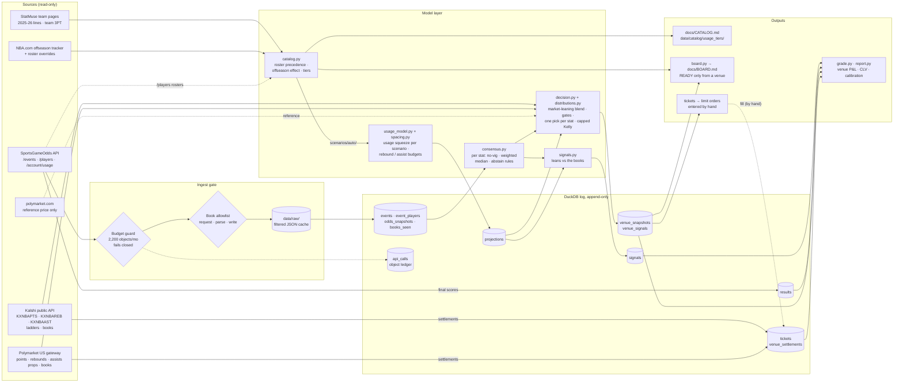
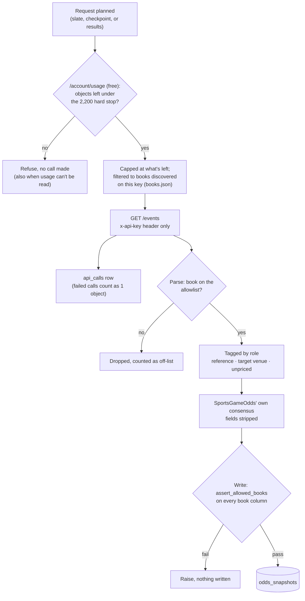
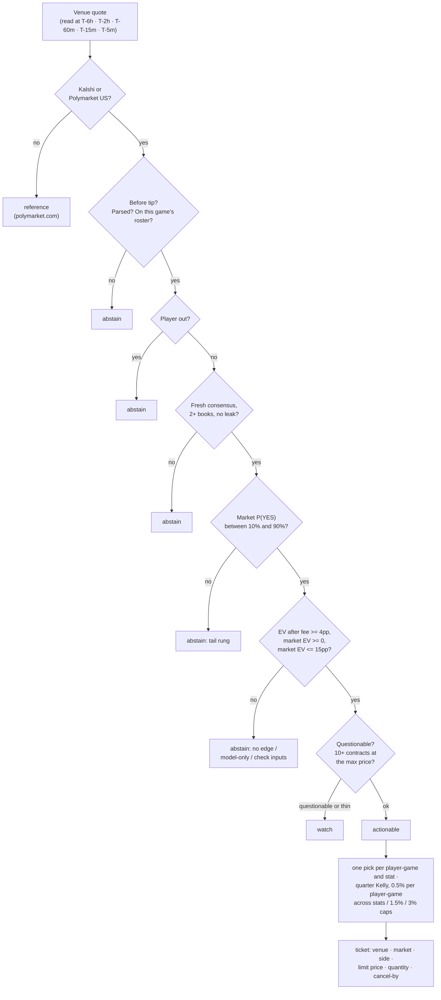
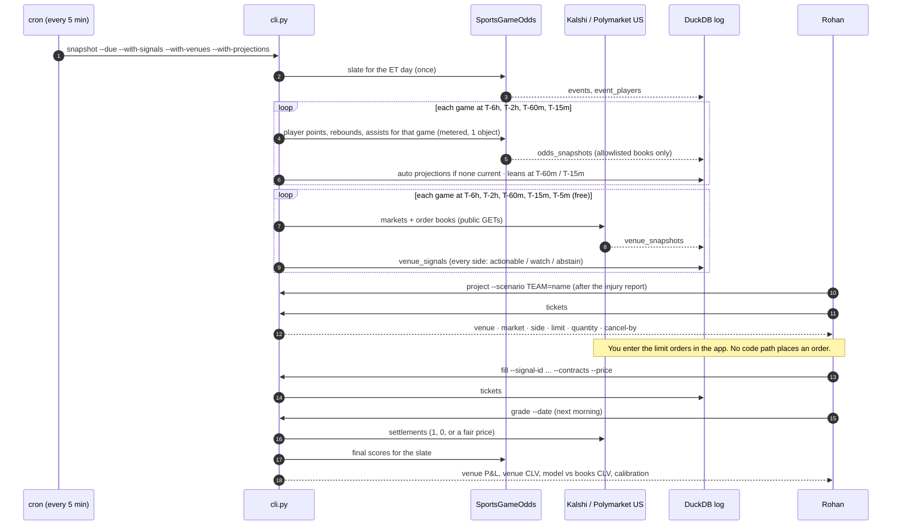
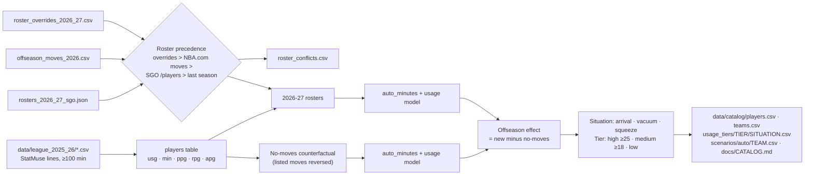

# Data architecture

Three layers:

- **Sources**, all read-only.
- **One append-only DuckDB log.** Every number the project relies on is written here before the game it concerns tips.
- **Outputs**, rebuilt from that log on demand.

Nothing flows back out: no venue account, no order endpoint, no write to any source.

## End to end

Arrows into the log only append rows. Arrows out of it are reads, limited to `SELECT` by `Storage.query`.

## The three gates on sportsbook data

Every SportsGameOdds response passes the same checks in order. Anything that fails is dropped before it can reach a table.

Only **reference** books build the consensus. Prediction markets that SportsGameOdds labels as targets are stored next to it but never enter it (this plan carries none). DFS apps are logged as unpriced. Kalshi and Polymarket US prices come from the venues' own public APIs, through the venue path below, and never touch the SportsGameOdds client or its budget.

## The venue decision path

Every Kalshi and Polymarket US contract side goes through the same gates in `decision.py`, against the consensus and projection of its own stat (points, rebounds or assists). The first gate that fails becomes the logged reason. Every side is logged, so nothing silently drops out.

## A game day, end to end

The cron entry runs every 5 minutes (see the README). It has two independent parts:
- the metered SportsGameOdds step, which calls only at a new checkpoint, so a typical slate costs a handful of objects;
- the free venue step, which runs even if the sportsbook step fails.

## Catalog build (no API calls)

`cli catalog` turns last season's lines and this offseason's moves into the league-wide list of role changes. The same code runs twice: once on the 2026-27 rosters, and once on a counterfactual where nobody moved. The difference between the two is the offseason effect, so a team's normal rotation churn never shows up as a role change.

Hand-reviewed scenarios in `cold_start_usage/scenarios/` (Miami, Toronto) take precedence over `scenarios/auto/`.

## Tables

| Table | Written by | Read by | One row is |
|---|---|---|---|
| `api_calls` | `sgo_client` | budget guard, `usage` | one billable request and its object count |
| `events` | `ingest` | everything game-scoped | one game at one snapshot |
| `event_players` | `ingest` | `project` | one rostered player and injury status |
| `odds_snapshots` | `ingest` | `consensus` | one book's over/under on one player and stat at one checkpoint |
| `books_seen` | `ingest` | `books`, allowlist audit | one book seen on one call, with its role |
| `projections` | `project`, cron (`--with-projections`) | `signals`, `venues`, `grade` | one player's mean and SD for one stat under one scenario, before tip (NULL mean: that stat had no inputs) |
| `signals` | `signals` | `watchlist`, `grade`, `report` | one model-vs-books comparison: a `paper` lean or `abstain` with a reason (never actionable) |
| `venue_snapshots` | `venues` (cron, `venues`, `board`) | `grade` (venue close for CLV) | one venue market's bid, ask and sizes at one checkpoint, with its stat; refused at or after tip |
| `venue_signals` | `venues` via `decision` | `board`, `tickets`, `watchlist`, `grade` | one contract side's decision and reason, with its stat, fair prices, EV, max price, size and a config hash; refused at or after tip |
| `tickets` | `fill` | `grade` | one fill entered by hand on a venue |
| `venue_settlements` | `grade` | `grade` | a market's settlement: 1, 0, or a fair price |
| `results` | `grade` | `grade`, `report` | one player's actual points, rebounds and assists plus the closing points consensus |

The `stat` column on odds, projections, signals and venue rows was added to existing tables in place; rows logged before it are NULL there, and every read treats NULL as points. Every timestamp is UTC. `--now` (simulated time) is refused on the default database, so the real log can't be back-dated.
