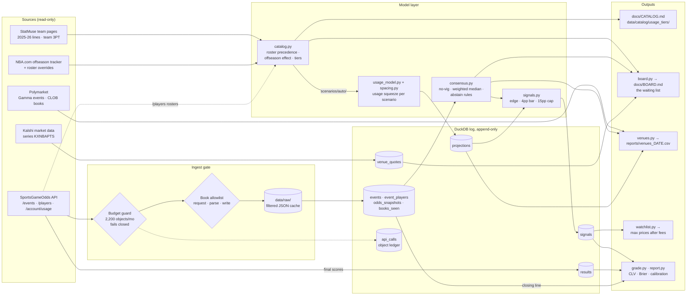
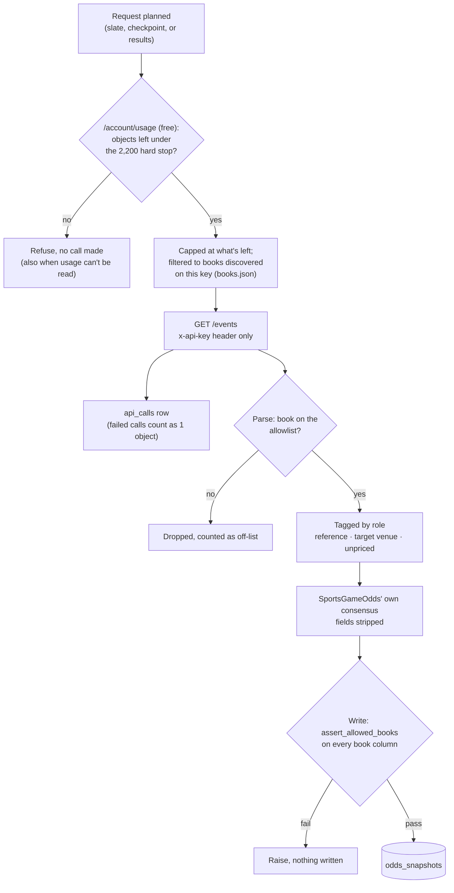
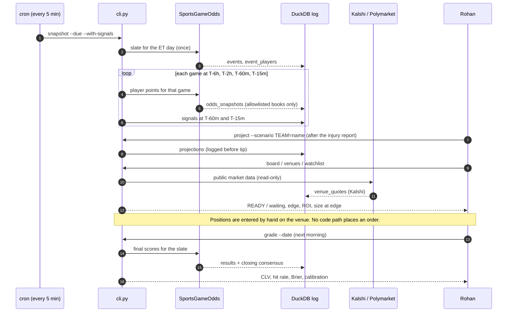
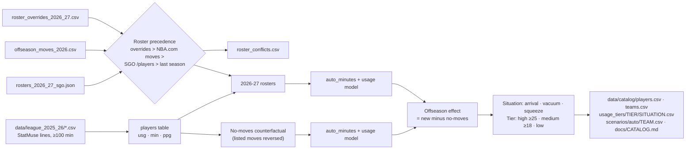

# Data architecture

Three layers:

- **Sources**, all read-only.
- **One append-only DuckDB log.** Every number the project relies on is written here before the game it concerns tips.
- **Outputs**, rebuilt from that log on demand.

Nothing flows back out: no venue account, no order endpoint, no write to any source.

## End to end

Arrows into the log only append rows. Arrows out of it are reads, limited to `SELECT` by `Storage.query`.

## The three gates on sportsbook data

Every SportsGameOdds response passes the same checks in order. Anything that fails is dropped before it can reach a table.

Only **reference** books build the consensus. Target venues (Kalshi, Novig, Polymarket) are stored next to the consensus but never enter it. DFS apps are logged as unpriced.

## A game day, end to end

The cron entry runs every 5 minutes (see the README). It calls the API only when a game reaches a new checkpoint, so a typical slate costs a handful of objects.

## Catalog build (no API calls)

`cli catalog` turns last season's lines and this offseason's moves into the league-wide list of role changes. The same code runs twice: once on the 2026-27 rosters, and once on a counterfactual where nobody moved. The difference between the two is the offseason effect, so a team's normal rotation churn never shows up as a role change.

Hand-reviewed scenarios in `nba_cold_start/scenarios/` (Miami, Toronto) take precedence over `scenarios/auto/`.

## Tables

| Table | Written by | Read by | One row is |
|---|---|---|---|
| `api_calls` | `sgo_client` | budget guard, `usage` | one billable request and its object count |
| `events` | `ingest` | everything game-scoped | one game at one snapshot |
| `event_players` | `ingest` | `project` | one rostered player and injury status |
| `odds_snapshots` | `ingest` | `consensus` | one book's over/under on one player at one checkpoint |
| `books_seen` | `ingest` | `books`, allowlist audit | one book seen on one call, with its role |
| `projections` | `project` | `signals`, `board`, `venues`, `grade` | one player's mean and SD under one scenario, before tip |
| `signals` | `signals` | `watchlist`, `grade`, `report` | one model-vs-consensus comparison, `paper` or `abstain` with a reason |
| `venue_quotes` | `kalshi`, `board`, `venues` | `board`, `watchlist` | one prediction-market rung's bid and ask at one time |
| `results` | `grade` | `grade`, `report` | one player's actual points plus the closing consensus |

Every timestamp is UTC. `--now` (simulated time) is refused on the default database, so the real log can't be back-dated.
