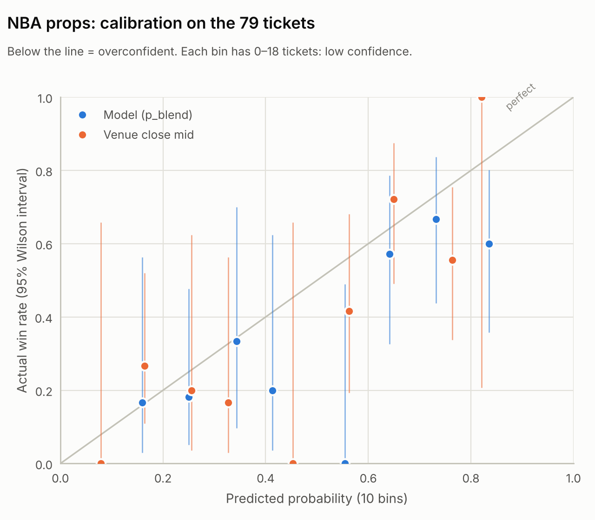
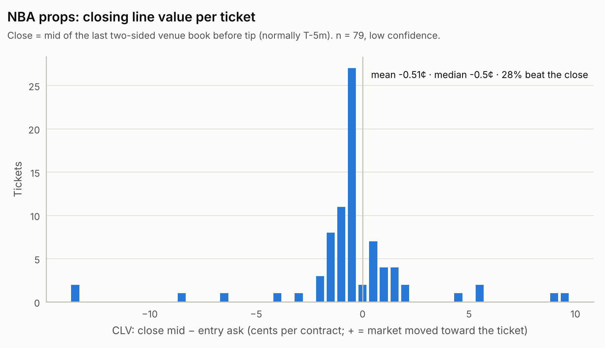
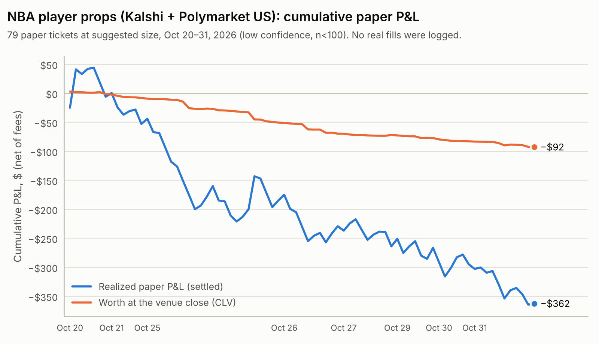
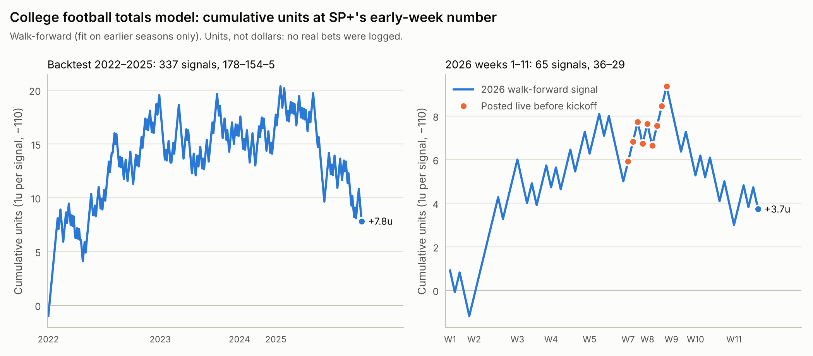
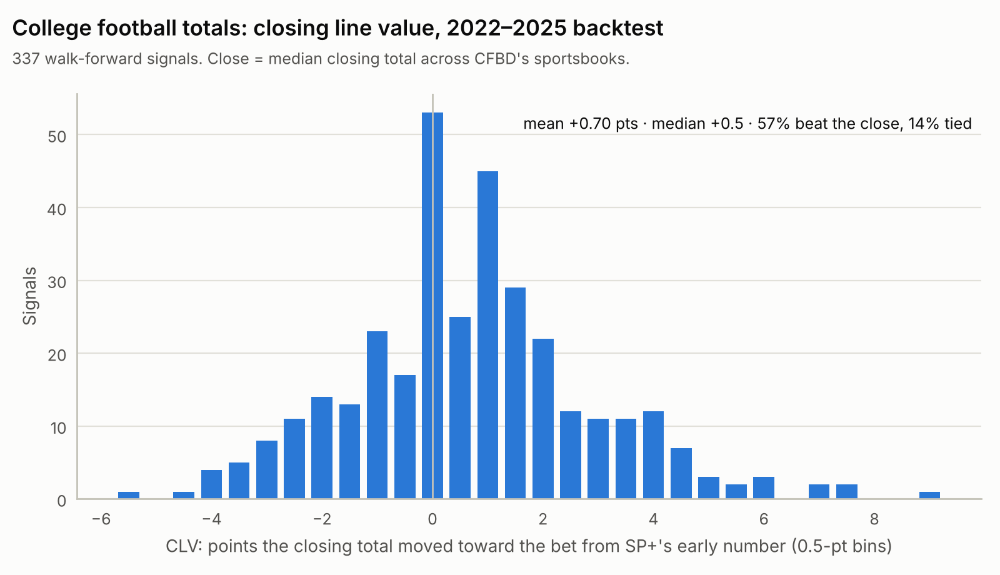
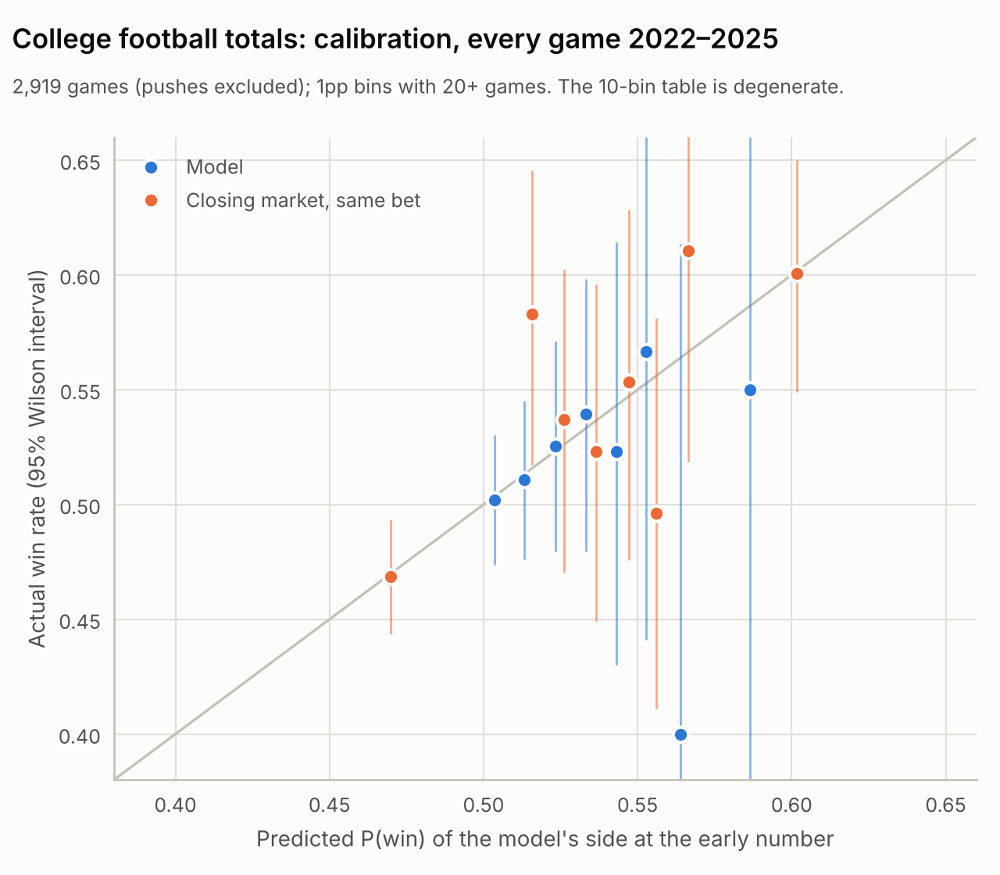

# Model portfolio: prediction-market and sports-pricing systems

Rohan Repala · prepared Tue Nov 17, 2026 (ET) · every number below comes from a script in
[`scripts/`](scripts/) run on data in the three repositories, and `scripts/run_all.sh` rebuilds all of them.
Outputs are in [`data/`](data/) and charts in [`charts/`](charts/).

## Read this first

1. **Nothing in these repositories is a real-money track record.** No fill of any kind (real, paper or
   discretionary) was ever logged for the NBA system (`bets/fills.csv` is empty), and the CFB repo's real-bets table
   is empty. Every P&L below is either a **paper** record (the system's own tickets at its suggested size and logged
   price) or a **unit** record (1 unit per signal at −110). Real-money P&L, fill rate and slippage are **not
   available** for any system.
2. **There is no live arbitrage system in any of the three repositories.** The only arbitrage code is a
   backtest strategy (`LadderArbitrage` in the NBA repo), and its backtest report records **0 trades**
   ([section 4](#4-live-arbitrage-system-not-found)). Correct this with the recruiter rather than describing one.
3. **The two pricing models have opposite results.** The NBA prop model's 79 paper tickets lost 25.5% of the capital they used, and its prices
   were *worse* than the venue's own closing price. The college football totals model shows **positive closing line
   value** over 337 walk-forward signals (+0.70 points a bet, 95% CI +0.46 to +0.93), but its profit is not
   statistically distinguishable from zero.

Results with fewer than 100 observations are marked **low-confidence**. Intervals are 95%.

## Summary

Generated by `scripts/summary_table.py` from `data/nba/metrics.json` and `data/cfb/metrics.json`. A Brier gap is
(market Brier − model Brier) on the same contracts, so **positive means the model beat the market**.

| Model | Venue | Status | Live since | n | Brier: model vs market close (gap, + = model better) | Mean CLV [95% CI] | Net P&L | ROI [95% CI] |
|---|---|---|---|---|---|---|---|---|
| NBA cold-start player props | Kalshi + Polymarket US | Paper (system tickets; 0 fills logged) | 2026-10-20 | 79 tickets (low-conf.) | 0.2340 vs 0.2205 (gap -0.0135 [-0.0310, +0.0040]) | -0.51¢ [-1.22, +0.20] | −$362.44 paper (real: not available) | -25.5% [-46.9%, -3.1%] |
| CFB totals, backtest 2022–2025 | Sportsbooks (FanDuel/DK/Fanatics) | Backtest (walk-forward) | n/a | 337 signals | 0.2496 vs 0.2432 (gap -0.0064 [-0.0128, +0.0001]) | +0.70 pts [+0.46, +0.93] | +7.82u (no $: not available) | +2.3% [-7.8%, +12.4%] |
| CFB totals, 2026 wks 1–11 | Sportsbooks | Walk-forward (wks 7–8 also posted live) | 2026-10-15 ET (live) | 65 signals (low-conf.) | 0.2473 vs 0.2391 (gap -0.0082 [-0.0214, +0.0050]) | +0.89 pts [+0.38, +1.40] | +3.73u | +5.7% [-17.5%, +29.0%] |
| CFB totals, posted live | Sportsbooks | Live signals, no real bets logged | 2026-10-15 ET | 9 graded + 10 pending (low-conf.) | 0.2308 vs 0.2173 (gap -0.0134 [-0.0624, +0.0355]) | +2.36 pts [+0.12, +4.60] | +4.36u (7-2-0) | +48.5% [-16.2%, +113.2%] |
| Live arbitrage system | — | Not found in any repo | not available | 0 | not available | not available | not available | not available |

The "market close" benchmark is the venue's last two-sided mid before tip (NBA) or the closing sportsbook total
priced at the bet's own line (CFB). The two models trade different markets, so their rows aren't comparable.

---

## 1. Inventory (Step 1)

### 1a. Data sources found, and how much each holds

Full list: [`data/inventory_sources.csv`](data/inventory_sources.csv) (261 rows, from `scripts/inventory.py`).
No SQLite or Postgres database, no log file and no Kalshi or Polymarket fills export exists in any of the three
repositories.

| Source | Repo | What it is | Size | Status here |
|---|---|---|---|---|
| `bets/ledger.csv` | NBA | One row per paper ticket: entry, all-in cost, size, model / books / blend probabilities, settlement, close, CLV | 79 rows, Oct 20–31, 2026 | committed; **the main NBA input** |
| `bets/days/*/tickets.csv` | NBA | Every actionable decision at every checkpoint (repeats flagged), with depth at the limit | 142 rows in 9 files | committed |
| `bets/days/*/results.csv`, `summary.md` | NBA | Each day's tickets graded; the journal's own day totals | 79 rows; 9 summaries | committed; used as a cross-check (all 9 days match) |
| `bets/fills.csv` | NBA | Fills entered by hand with `cli fill` | **0 rows** | committed (header only) |
| `data/edge_lab.duckdb` | NBA | The full decision log: every venue price read, every decision incl. non-actionable, fills, settlements, sportsbook odds | — | **not available**: git-ignored, on the owner's machine |
| `data/history/` | NBA | Kalshi's 2025-26 NBA points archive with 1-minute candles (the backtest input) | — | **not available**: git-ignored |
| `data/cron.log` | NBA | Cron run log (uptime) | — | **not available**: git-ignored |
| `data/league_2025_26/*.csv`, `players_2025_26.csv`, `scenarios/` | NBA | Model inputs: 2025-26 player lines, rosters, minutes scenarios | 538 / 512 / 1,769 rows | committed (inputs, not results) |
| `docs/BACKTEST.md`, `docs/MODEL_V2_EVAL.md` | NBA | Reports generated from the two git-ignored stores | — | quoted in section 2f, **not recomputed** |
| `2026/week-NN/bets.csv` | CFB | Each week's signals and results (`posted` = live before kickoff; `backfilled` = backtest) | 95 rows in 12 files | committed weeks 1–8; weeks 8–12 updated / written this session |
| `2026/week-NN/ratings.csv` | CFB | Every FBS game: line, model line, win probability, totals | 818 rows | same |
| `data/cfb.duckdb` (rebuilt) | CFB | games 30,646 · lines 54,233 · source_projections 8,938 · source_ratings 28,658 · **bets (real) 0** | 172,033 rows | git-ignored; **rebuilt this session** from CFBD, SP+ sheets and BCF Toys (`data/cfb/PROVENANCE.md`) |
| `data/cfb/games_2022_2026.csv` | (export) | Per-game model vs market probabilities, 2022–2026 | 3,564 games | `scripts/cfb_export.py`; reproduces the repo's own signals exactly |
| `data/csc/…`, `data/players/…`, `data/benchmark/…` | NIL | College Sports Commission pay releases, benchmark curves, roster values | 3 archived releases + 12 NIL data reports; 246 percentile rows; 195 curve rows | committed; not a trading dataset |

### 1b. Models, strategies and systems

| | NBA cold-start player props | CFB totals / spreads | NIL pay benchmark | "Live arbitrage system" |
|---|---|---|---|---|
| **Predicts / trades** | Kalshi `KXNBAPTS/REB/AST` "N+" ladders and Polymarket US NBA player props: points, rebounds, assists (threes, steals, blocks, turnovers and combos are priced as shadow stats, never ticketed) | FBS game totals (headline rule: over/under at SP+'s early-week number) and spreads at FanDuel / DraftKings / Fanatics | Percentiles of college-athlete pay (CSC NIL Go and revenue-share reports) | — |
| **Approach** | Closed-form usage-redistribution model (usage elasticity `(20/usg)^γ` inside a 4,800 team-usage budget; rebound / assist team budgets with diminishing returns ρ = 0.6 / 0.5) over hand-reviewed minutes scenarios. Points priced as a normal (SD max(4, 0.3μ)) and compound-Poisson, the lower of the two; rebounds / assists negative binomial at two dispersions. The traded probability **leans on the market**: sportsbook consensus mean + 20% × (model − consensus). Gates: ≥ 4pp EV after fee, not a tail (10–90%), ≥ 10 contracts at the limit. Quarter Kelly, capped at 0.5% of bankroll per player-game, 1.5% per game, 3% per slate | Blend of public ratings (for totals: SP+ ≈ 0.80, BCF Toys FEI ≈ 0.20, weights fit by least squares) shrunk toward the market line (α fit per season), turned into a full total-points distribution (picked each season by walk-forward cover log loss over 5,933 games, 2014–2025: a frequency-weighted normal in 3 of 4 seasons). Bet when EV at −110 ≥ +2% | Curves through published percentiles; no prediction of outcomes | not found |
| **Training / validation** | Mostly frozen priors (ρ from the lineup literature, dispersions from 2021–24 box scores; `eff_per_usg_point` guessed, spacing switched off). Graded walk-forward against the books' close; a rolling v2 exists behind a flag. Price-only strategies backtested on Kalshi's 2025-26 archive with an April-onward holdout still sealed | Walk-forward by season: weights, α and distribution fit only on earlier seasons; SP+ and BCF projections are their pre-game weekly archives | Out-of-sample checks on suppressed cohorts | — |
| **Status** | **Paper.** Cron-driven logging since Opening Night, Oct 20, 2026; the committed journal has tickets on 9 slates from Oct 20 to Oct 31 (none on Oct 23, 24 or 28). No order code by design (`tests/test_venue_ops.py`) | **Backtest 2022–2025; live signals since Oct 15, 2026** (weeks 7, 8, 12). No real bets logged | Production data product (daily capture), no trading | not found |
| **Stored in** | `data/edge_lab.duckdb` (git-ignored) → committed journal `bets/` | `data/cfb.duckdb` (git-ignored) → committed `2026/week-NN/` | `data/csc/releases/` | — |

The NIL repository is a pay-benchmark tool with no betting or market content, so it gets no metrics section.

---

## 2. NBA cold-start player-prop model (Kalshi + Polymarket US)

**Sample: 79 paper tickets, 9 slates, Oct 20–31, 2026. LOW-CONFIDENCE (n < 100).** 46 Kalshi, 33 Polymarket US;
38 points, 24 assists, 17 rebounds. The pipeline logged 142 actionable rows (79 became tickets, 52 were repeats of an
already-ticketed contract, 11 were a different contract on an already-ticketed player-stat), and **0 fills**.
Script: `scripts/nba_metrics.py` → `data/nba/`.

### 2a. Model vs market

| Forecast on the same 79 contracts | Brier | Log loss |
|---|---|---|
| Model (traded probability, `p_blend`) | 0.2340 | 0.6711 |
| Sportsbook consensus alone (`p_market`) | 0.2297 | 0.6595 |
| Venue price at entry (ask) | 0.2184 | 0.6299 |
| **Venue close (last two-sided mid before tip)** | **0.2205** | **0.6354** |

- **Gap vs the close: −0.0135 Brier** (95% CI −0.031 to +0.004; by-date bootstrap −0.021 to −0.004), log loss
  −0.036 (CI −0.083 to +0.012). The model was **worse** than the venue's own price; the t-interval just includes zero.
- Even the entry ask beat it: gap −0.0156 (CI −0.0310 to −0.0003).
- On the contracts it chose, the sportsbook consensus was also worse than the venue (0.2297 vs 0.2205): the
  thesis that the venues lag the books did not hold here.

### 2b. Calibration

The model expected **45.2 wins and got 35** (z = −2.63). The books alone expected 43.7, the venue close 39.3.

| Bin | n | Model predicted | Actual | Venue-close bin n | Close predicted | Actual |
|---|---|---|---|---|---|---|
| 0.0–0.1 | 0 | — | — | 2 | 0.073 | 0.000 |
| 0.1–0.2 | 6 | 0.166 | 0.167 | 15 | 0.158 | 0.267 |
| 0.2–0.3 | 11 | 0.256 | 0.182 | 5 | 0.250 | 0.200 |
| 0.3–0.4 | 6 | 0.350 | 0.333 | 6 | 0.321 | 0.167 |
| 0.4–0.5 | 5 | 0.419 | 0.200 | 2 | 0.448 | 0.000 |
| 0.5–0.6 | 4 | 0.560 | 0.000 | 12 | 0.556 | 0.417 |
| 0.6–0.7 | 14 | 0.647 | 0.571 | 18 | 0.643 | 0.722 |
| 0.7–0.8 | 18 | 0.738 | 0.667 | 18 | 0.757 | 0.556 |
| 0.8–0.9 | 15 | 0.841 | 0.600 | 1 | 0.815 | 1.000 |
| 0.9–1.0 | 0 | — | — | 0 | — | — |

Wilson intervals per bin are in `data/nba/calibration.csv`. Every bin has fewer than 20 tickets.

<picture><source media="(prefers-color-scheme: dark)" srcset="charts/nba_calibration-dark.png"></picture>

### 2c. Closing line value

Close = mid of the last two-sided venue book the system read before tip (normally the T-5m checkpoint), for the
ticket's side. CLV = close − entry ask.

| | Value | 95% CI |
|---|---|---|
| Mean CLV, cents per contract | **−0.51¢** | −1.22 to +0.20 (by-date bootstrap −1.11 to +0.35) |
| Median CLV | −0.5¢ | — |
| Mean CLV, % of entry price | −2.30% | −4.48 to −0.11 |
| Median CLV, % | −0.78% | — |
| Mean CLV after the venue fee (close − all-in cost) | −2.21¢ | −2.91 to −1.51 |
| Beat the close / tied / worse | 22 (27.8%) / 2 (2.5%) / 55 (69.6%) | beat: 19.2% to 38.6% |

The median of exactly −0.5¢ is half of a one-cent spread: on the typical ticket the price didn't move, and buying at
the ask cost half the spread against the mid.

<picture><source media="(prefers-color-scheme: dark)" srcset="charts/nba_clv_distribution-dark.png"></picture>

### 2d. Paper P&L (net of Kalshi / Polymarket US fees)

| | Value |
|---|---|
| Tickets / contracts | 79 / 3,487 (median 36 a ticket; median stake $24.43, max $24.99) |
| Capital deployed | $1,419.44 |
| **Net P&L** | **−$362.44** (95% CI −$677.94 to −$43.55 by ticket; −$606.10 to −$173.90 by date) |
| Gross before fees and book-walk | −$301.59 |
| Venue fees (recomputed with `cold_start_usage/fees.py`) | $45.55 |
| Walk up the book and rounding | $15.31 |
| P&L per contract | −10.4¢ |
| **ROI on capital deployed** | **−25.5%** (CI −46.9% to −3.1% by ticket; −33.2% to −15.5% by date) |
| Worth at the close (Σ contracts × (close − all-in cost)) | −$92.45 |
| Win rate | 44.3% (35 of 79; CI 33.9% to 55.3%) |
| Average edge at entry (model − ask, before fee) | +7.0pp (CI 6.6 to 7.4) |
| Average EV after fee (model) | +5.3pp; books alone − ask: +5.1pp |
| Real-money P&L, fill rate, slippage vs limit | **not available**: no fills logged |

The paper loss (−$362) is about four times what the tickets were worth at the close (−$92): most of it is
outcome variance on top of a small negative CLV.

<picture><source media="(prefers-color-scheme: dark)" srcset="charts/nba_cumulative_pnl-dark.png"></picture>

### 2e. Risk and splits

- **Daily** (9 slates, low-confidence): every one of the 9 days lost. Mean −$40.27 a day (CI −$70.79 to −$9.76), SD
  $39.70, **daily Sharpe −1.01** (approx. SE 0.41; on daily return on capital, −1.73). Not annualized: 9 days can't
  support it.
- **Max drawdown $408.53**, from +$44.20 after the 5th ticket to −$364.33 after the 78th.
- **Longest losing streak 8 tickets** (longest winning streak 3).

| Split | Tickets | Win rate | Hits / expected | Brier model / close | Mean CLV | Capital | Net P&L | ROI |
|---|---|---|---|---|---|---|---|---|
| Points | 38 | 52.6% | 20 / 26.5 | 0.261 / 0.241 | −0.01¢ | $734.55 | −$108.55 | −14.8% |
| Assists | 24 | 45.8% | 11 / 12.2 | 0.192 / 0.188 | −0.21¢ | $408.30 | −$192.30 | −47.1% |
| Rebounds | 17 | 23.5% | 4 / 6.6 | 0.232 / 0.221 | −2.03¢ | $276.59 | −$61.59 | −22.3% |
| Kalshi | 46 | 41.3% | 19 / 24.5 | 0.191 / 0.180 | −0.29¢ | $855.55 | −$258.55 | −30.2% |
| Polymarket US | 33 | 48.5% | 16 / 20.7 | 0.293 / 0.278 | −0.80¢ | $563.89 | −$103.89 | −18.4% |

All splits are low-confidence. By month: all 79 tickets are in October 2026 (one month), so a monthly split
isn't possible. Day-by-day, checkpoint and side splits: `data/nba/by_date_et.csv`, `by_checkpoint.csv`, `by_side.csv`.
PRA and other combos were priced only as shadow stats, never ticketed, so they have no rows.

### 2f. Reported by the repo, not recomputed (input data is git-ignored)

- **Kalshi archive backtest** (`docs/BACKTEST.md`, 23,543 settled points markets, 1,096 games, Nov 2025 to Jun 2026):
  buying every YES lost 9.1%; no strategy using Kalshi prices alone beat the spread and fee; "ladder fit" as resting
  limit orders at T-60m was the only positive one (+4.8% on 366 fills, CI −2.6% to +11.4%). The April-onward
  holdout is still sealed.
- **Projection accuracy** (`docs/MODEL_V2_EVAL.md`, in-sample Oct 20–26, every player-game, not just tickets):
  points Brier 0.268 for the model vs 0.249 for the books' close (n = 395); rebounds 0.259 vs 0.244; assists 0.260
  vs 0.243.

### 2g. Limitations

- Paper tickets only, at the logged ask with a modeled book walk. Real fill rates, queue position and slippage
  are unknown.
- 79 tickets over 12 days is far short of the repo's own bar for tuning (about 800 graded rows).
- November is missing: if the cron kept running after Nov 1, the decisions are in the git-ignored local log
  (`grade` then `journal --all` would add them).
- "Close" is the last book the system read, normally 5 minutes before tip, not the true last trade.

---

## 3. College football totals model

Script: `scripts/cfb_export.py` (runs in the CFB repo's environment) → `scripts/cfb_metrics.py` → `data/cfb/`.
The CFB pipeline was rebuilt from scratch this session and brought to the current week:
- Week 8 was graded (4–1).
- Weeks 9–11 were published as **backtest**, because their games had already been played.
- **Week 12 was posted live** on Nov 17 before every kickoff.
- The rebuild reproduces all 53 previously committed signals exactly.

Provenance: `data/cfb/PROVENANCE.md`.

### 3a. Headline rule (totals at SP+'s early-week number), walk-forward

| | Backtest 2022–2025 | 2026 weeks 1–11 (low-confidence) |
|---|---|---|
| Signals, dates | 337, Sep 1 2022 – Dec 13 2025 | 65, Sep 5 – Nov 15, 2026 |
| Record | 178–154–5 | 36–29 |
| Win rate (no pushes) vs 52.38% break-even | 53.6% (CI 48.2% to 58.9%) | 55.4% (CI 43.3% to 66.8%) |
| Units (1u per signal, −110) | +7.82u | +3.73u |
| ROI per unit risked | +2.3% (CI −7.8% to +12.4%) | +5.7% (CI −17.5% to +29.0%) |
| **Mean CLV, points** | **+0.70 (CI +0.46 to +0.93)**, median +0.5 | +0.89 (CI +0.38 to +1.40), median +1.0 |
| CLV net of the season's early-to-close drift | +0.67 (CI +0.44 to +0.91) | +0.88 (CI +0.36 to +1.40) |
| CLV in win probability (1pp = 1¢ on a $1 contract) | +2.05pp (CI 1.46 to 2.63), median +1.55 | +2.90pp (CI 1.63 to 4.16) |
| Beat / tied / worse than the close | 56.7% / 13.6% / 29.7% | 66.2% / 7.7% / 26.2% |
| Brier on the signals: model / closing market / early market | 0.2496 / 0.2432 / 0.2500 | 0.2473 / 0.2391 / 0.2500 |
| Log loss: model / closing market / early market | 0.6924 / 0.6795 / 0.6931 | 0.6876 / 0.6709 / 0.6931 |
| Average EV at entry | +4.4% | +4.1% |
| Max drawdown | 12.5u | 6.4u |
| Longest losing streak | 6 | 3 |
| Weekly "Sharpe" (mean / SD of weekly units) | 0.06 (59 weeks, 30 losing) | 0.12 (11 weeks, 5 losing) |

By season (backtest): 2022 120 signals, 71–45–4, +19.5u; 2023 85, 42–42–1, −3.8u; 2024 39, 21–18, +1.1u; 2025 93,
44–49, −9.0u. **CLV was positive in every season** (+0.98, +0.58, +0.01, +0.73 points), including 2025, which lost money.
By side: overs 95–83–1 (+3.4u, drift-adjusted CLV +0.95), unders 83–71–4 (+4.5u, +0.37).

The closing market at the bet's own line is a better forecast than the model, as it should be: it knows more.
Against the number actually available at bet time (the early market, which is about 50%), the model is level
(Brier gap +0.0004, CI −0.005 to +0.006). The edge shows up in **where the line goes**, not in sharper probabilities.
In the re-run backtest report, the close moves 0.11 points (SE 0.010) toward the rating sources for every point they
disagree with the early number (`data/cfb/backtest_totals_2026-11-18.md`).

**All games, 2022–2025** (2,919 games, not just signals): at the early number the model is level with the early market
(Brier 0.2498 vs 0.2500); at the closing number it adds nothing (log loss 0.6934 vs 0.6931 for a coin flip).

<picture><source media="(prefers-color-scheme: dark)" srcset="charts/cfb_cumulative_units-dark.png"></picture>

<picture><source media="(prefers-color-scheme: dark)" srcset="charts/cfb_clv_distribution-dark.png"></picture>

### 3b. Calibration

The 10-bin table is degenerate: every model probability sits between 0.50 and 0.63. Across all games 2022–2025, the
0.5–0.6 bin has 2,916 games (predicted 0.517, actual 0.514), the 0.6–0.7 bin has 3 games (predicted 0.626, actual 0.000),
and every other bin is empty. At 1pp bins (`data/cfb/calibration_zoom.csv`) the model tracks the diagonal within its
intervals: 0.505→0.502 (n 1,197), 0.514→0.511 (795), 0.524→0.525 (451), 0.534→0.539 (267), 0.544→0.523 (109).

<picture><source media="(prefers-color-scheme: dark)" srcset="charts/cfb_calibration-dark.png"></picture>

### 3c. Posted live, before kickoff

| | Value |
|---|---|
| Posted | 19 signals in weeks 7, 8, 12 (first posted Oct 15, 2026, 10:00 PM ET) |
| Graded | 9 (weeks 7–8): **7–2, +4.36u**, ROI +48.5% (CI −16% to +113%). LOW-CONFIDENCE |
| CLV (graded) | +2.36 points (CI +0.12 to +4.60); 7 of 9 beat the close |
| Brier, model / close (graded) | 0.2308 / 0.2173 |
| Week 8 at the book's number when posted | 4 of 5 picks were already below +2% EV at DraftKings; regraded there: still 4–1, +2.64u; the close moved a further +2.15 points toward the picks from that number (CI +0.62 to +3.68) |
| Pending | Week 12: 9 totals + 1 spread, kicking off Nov 18–21 (`data/cfb/2026/week-12/`) |

### 3d. Limitations

- Units, not dollars: no real bet was logged, so $ P&L, ROI on capital and execution are **not available**.
- Graded at SP+'s early-week number at −110. That number isn't always available by the time a signal is posted
  (week 8 above), and prices other than −110 aren't modeled.
- BCF Toys publish times are inferred (one hour before each week's first kickoff). The blend's early-number
  backtest may use a BCF projection that didn't exist yet when the early number was printed. The timing-safe check is
  SP+ alone at the early number: 338 bets, 177–156, +4.9u, drift-adjusted CLV +0.33 (equal weights; re-run report).
- Closing lines are the median of CFBD's retail books, not a sharp close.

---

## 4. Live arbitrage system: not found

All three repositories (every branch) were searched for arbitrage, cross-venue, legging and both-legs logic. The
only hits are in the NBA repo:

- `cold_start_usage/strategies.py: LadderArbitrage`: a **backtest-only** strategy that buys YES on a lower rung and
  NO on a higher rung of the same Kalshi player-points ladder when both cost under $1 after fees (a guaranteed
  payout), read 60 minutes before tip.
- `docs/BACKTEST.md` reports **0 fills** for it across 23,543 settled Kalshi NBA points markets in 1,096 games (Nov 2025
  to Jun 2026). The archive behind that report is git-ignored, so it is quoted, not recomputed.

Nothing places orders: the NBA tool has no order or account code by design, enforced by a test. There are no
order, fill, latency or uptime logs for any arbitrage.

| Requested arb metric | Status |
|---|---|
| Venues and pairs watched | The NBA scanner *reads* Kalshi and Polymarket US at every checkpoint, but no arbitrage logic runs on it live |
| Opportunities detected vs executed (fill rate) | not available: no detection log, no orders |
| Theoretical vs realized edge per arb | not available: 0 opportunities in the backtest, no live trades |
| Legging risk (one leg filled) | not available: no orders |
| Total P&L, capital, return, daily series, drawdown | not available |
| Detection-to-order latency, uptime, time live | not available: no such system; `data/cron.log` (NBA scanner uptime) is git-ignored |

If this system exists somewhere else (another repository, a local folder), it is not in these three repositories,
and none of the numbers above can be produced for it.

---

## 5. What didn't work, and what I'd change

**NBA props**
- **The core thesis didn't hold in this sample.** On the contracts I picked, the venue was better calibrated than the
  sportsbook consensus I treated as fair value (Brier 0.2205 vs 0.2297). Picking only where we disagree with the
  venue is adverse selection when the venue is right. *Change:* weight the venue price itself in the fair value,
  and require the sportsbook move to *lead* the venue (a timing signal) rather than just differ from it.
- **Overconfident probabilities**: 45 wins expected, 35 delivered. *Change:* shrink the traded probability toward
  the venue mid, and refit the dispersion models on graded rows before trusting another edge.
- **Crossing the spread.** The median ticket paid half a cent against the close mid, plus $45.55 of fees (13% of the
  loss). *Change:* rest limit orders. Kalshi player props charge no maker fee, and resting limits were the only
  positive strategy in the archive backtest.
- **Rebounds** (4 of 17, CLV −2.0¢) were the worst stat. The code already requires 2pp more edge on them since Oct 25.
- **No fills logged.** *Change:* log every real or paper order with `cli fill`, so fill rate and slippage exist.

**CFB totals**
- **Profit isn't significant yet.** +2.3% ROI with a 5.2% standard error over 337 bets. Confirming a 2% edge needs
  thousands of bets. CLV is the better evidence, and it's positive in every season.
- **The edge is timing, not forecasting.** The model only beats the early number. *Change:* post the moment SP+'s
  sheet publishes (week 8's picks were mostly gone at DraftKings by posting time), and line-shop more books.
- **2025 lost 9 units despite +0.73 CLV**: a reminder that one season of P&L says little.
- **Inferred BCF timestamps.** *Change:* snapshot BCF's page weekly so publish times are recorded, not inferred.

**Process**
- Two of the three systems have meaningful samples and none has a real-money record. The single most valuable
  next step is small, logged real trades on the CFB early-number rule, to measure execution against the backtest.
