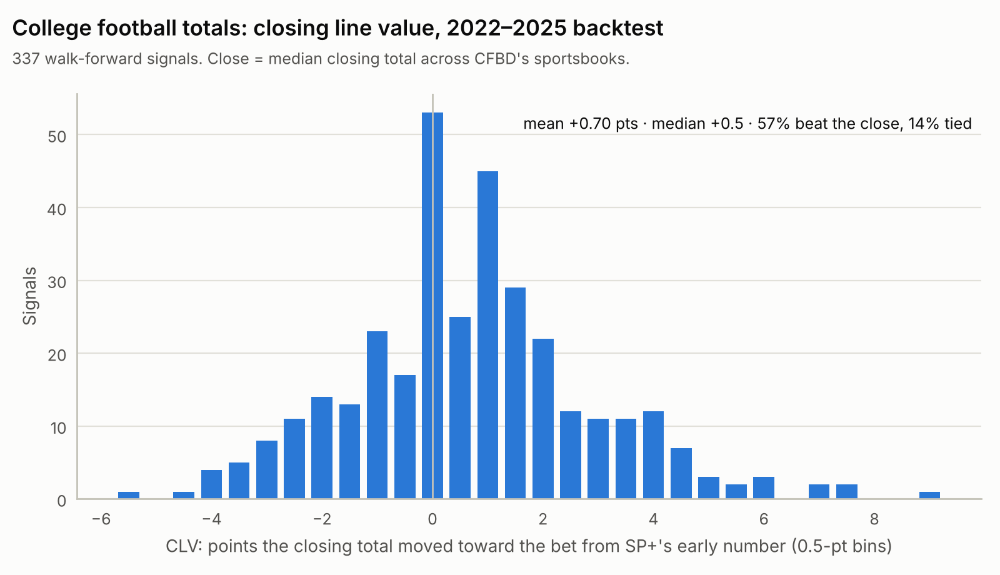

# Rohan Repala: sports and prediction-market models

Every figure here is computed from logged data by a script anyone can rerun (`perf_report/scripts/run_all.sh`).
Nothing below is a real-money record: the systems are paper-traded or backtested, and I say which each time.

## What I built

**1. A pricing engine for NBA player props on Kalshi and Polymarket US** (the two CFTC-regulated US prediction
markets). At set times before every game it reads both venues' order books and prices each "N+ points, rebounds
or assists" contract against a sportsbook consensus and my own projection model. It also nets out each venue's
fee and sizes the position with capped Kelly. Every decision is logged *before* the game starts, and graded
afterward at the venue's own settlement.

**2. A college football totals model** that blends two public rating systems (SP+, FEI) with the betting
market into a full probability distribution of points scored, then flags over/unders where the early-week number
looks wrong. It is tested walk-forward: each season is predicted with a model fit only on the seasons before it.

## The strongest numbers

| | Result | Sample |
|---|---|---|
| **College football: beats the closing line** | The market moved **+0.70 points toward my pick** on average (95% range +0.46 to +0.93); 57% of picks beat the close | 337 picks, 2022–2025 backtest |
| …in every season | Closing line value positive in **all four seasons** (2024 only barely: +0.01) | 4 seasons |
| …and this season | **+0.89 points** a pick (+0.38 to +1.40); 36–29, +3.7 units | 65 picks, 2026 weeks 1–11 (small sample) |
| …posted publicly before kickoff | **7–2, +4.4 units**; the line moved +2.4 points toward the picks | 9 picks, Oct 2026 (small sample); 10 more logged before this weekend's games |
| **NBA props: honest grading** | 79 paper trades on Kalshi and Polymarket US, graded against the venue's own closing price. The record showed **no edge (−25% on paper)** before any real fill was logged | 79 trades, Oct 20–31, 2026 (small sample) |

<picture><source media="(prefers-color-scheme: dark)" srcset="charts/cfb_clv_distribution-dark.png"></picture>

## What a trading desk would care about

- **I measure edge with closing line value, not wins.** The football model's profit (+2.3% over 337 picks) is
  still within the range luck could produce. Its closing line value is 5.8 standard errors above zero.
- **I log before the outcome and grade at the real price.** The NBA system refuses to log a decision after tip-off, and
  the football record labels anything published after kickoff as backtest. NBA grading uses the venue's settlement and fees. When rebuilt from scratch, the football record
  reproduced all 53 previously published picks exactly.
- **I kill or fix things that don't work.** Twelve days of NBA data showed the venues were priced better than the
  sportsbooks I was benchmarking against. That's an answer, reached cheaply, on paper.

## Honest limits

- No real-money track record yet (no fills logged on any venue).
- The NBA sample is small (79 trades) and negative. The college football profit isn't statistically significant
  yet; its closing line value is.
- The "live arbitrage system" isn't among these projects. The only arbitrage work is a backtest that found no trades.
